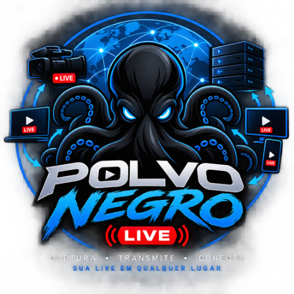
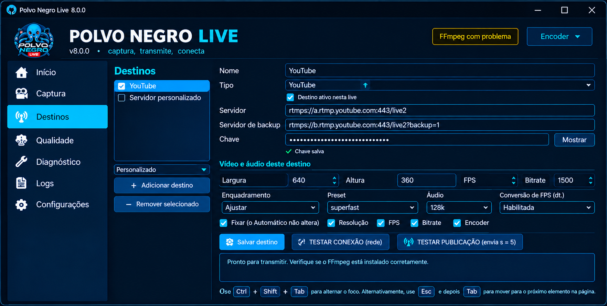
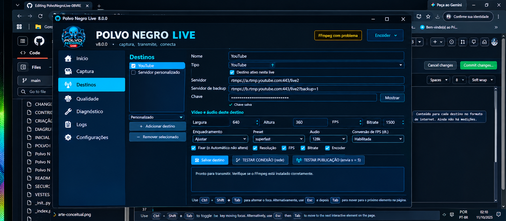

 <p align="center">
  
</p>

<h1 align="center">🐙 Polvo Negro Live</h1>

<p align="center">
  <strong>Captura, processamento e transmissão de áudio e vídeo para Windows, com foco em computadores com recursos limitados.</strong>
</p>

<p align="center">
  
  
  
  
</p>

---

## 📌 Sobre o projeto

O **Polvo Negro Live** é um projeto desenvolvido por **Diêgo Botelho Pereira**, criado com o objetivo de oferecer uma alternativa modular para captura, processamento e transmissão de áudio e vídeo em computadores Windows.

A proposta é buscar uma solução prática, organizada e adaptável, especialmente para computadores com recursos limitados, evitando dependências desnecessárias sempre que possível.

O projeto utiliza Python para a aplicação e FFmpeg para tarefas de processamento de mídia, de acordo com os recursos implementados no código.

O Polvo Negro Live está em desenvolvimento. As funcionalidades disponíveis dependem da versão publicada, das dependências instaladas, dos dispositivos utilizados e dos testes realizados.

## 🎯 Objetivos

- Facilitar a captura de vídeo e áudio.
- Permitir o uso de câmeras e placas de captura USB compatíveis.
- Processar mídia com FFmpeg.
- Organizar transmissões horizontais e verticais.
- Configurar destinos de transmissão compatíveis com RTMP e RTMPS.
- Facilitar o diagnóstico de problemas.
- Buscar menor consumo de recursos em computadores modestos.
- Manter o projeto organizado e fácil de instalar, executar e atualizar.
- Oferecer documentação clara para usuários e colaboradores.

## 🖥️ Interface do programa

Esta seção apresenta as imagens da interface do Polvo Negro Live disponíveis no repositório.

### Logotipo oficial

<p align="center">
  
</p>

### Painel principal

A captura de tela do painel principal ainda precisa ser enviada para a pasta `imagem/`. Assim que o arquivo real `painel-principal.png` estiver publicado, ele poderá ser adicionado aqui.

### Painel de configurações

<p align="center">
  
</p>

### Painel de transmissão

<p align="center">
  
</p>

### Painel de diagnóstico

<p align="center">
  
</p>

As imagens são carregadas diretamente dos arquivos publicados no GitHub. Para que apareçam corretamente, os caminhos, os nomes e as extensões devem corresponder exatamente aos arquivos existentes.

## ⚙️ Recursos do sistema

De acordo com os componentes presentes no projeto, os recursos podem incluir:

- Interface gráfica baseada em Python e Tkinter.
- Captura de vídeo por dispositivos compatíveis.
- Seleção de dispositivos de áudio.
- Processamento de mídia utilizando FFmpeg.
- Configuração de parâmetros de transmissão.
- Perfis de orientação horizontal e vertical.
- Configuração de destinos de streaming.
- Diagnóstico e registros de execução.
- Verificações para ajudar a identificar problemas.
- Organização modular dos componentes.

A disponibilidade de cada recurso deve ser confirmada na implementação atual. A documentação não substitui os testes práticos do aplicativo.

## 🧩 Como funciona

O fluxo conceitual do sistema é:

```text
┌──────────────────────────────────┐
│      Câmera ou captura USB        │
│      Microfone e áudio            │
└────────────────┬─────────────────┘
                 │
                 ▼
┌──────────────────────────────────┐
│       Captura de mídia            │
│       Processamento FFmpeg        │
└────────────────┬─────────────────┘
                 │
                 ▼
┌──────────────────────────────────┐
│      Configuração da transmissão  │
│      Resolução, FPS e áudio       │
└────────────────┬─────────────────┘
                 │
           ┌─────┴─────┐
           ▼           ▼
┌────────────────┐ ┌────────────────┐
│ Destino RTMP   │ │ Destino RTMPS   │
└────────────────┘ └────────────────┘
```

Este diagrama representa o funcionamento pretendido em termos gerais. Os detalhes dependem dos módulos efetivamente implementados.

## 💻 Requisitos

### Sistema operacional

- Windows 10 ou Windows 11, preferencialmente de 64 bits.
- Drivers compatíveis com os dispositivos de captura.
- Permissões para acessar câmeras, microfones e arquivos.

### Dependências

As dependências exatas devem ser verificadas nos arquivos do projeto, especialmente em `requirements.txt` e nos scripts de inicialização.

Conforme a implementação, podem ser necessários:

- Python compatível com o código-fonte.
- FFmpeg.
- Bibliotecas Python listadas em `requirements.txt`.
- Componentes necessários para a interface gráfica.

Se o projeto for distribuído por um executável, os requisitos poderão ser diferentes daqueles necessários para executar o código-fonte.

## 🚀 Como obter o projeto

Repositório oficial:

**https://github.com/PolvoNegroLive/PolvoNegroLive-08V**

Para clonar o projeto, se o Git estiver instalado, abra o terminal e execute:

```bash
git clone https://github.com/PolvoNegroLive/PolvoNegroLive-08V.git
cd PolvoNegroLive-08V
```

Outra opção é abrir o repositório no GitHub, clicar em **Code** e escolher **Download ZIP**.

## ▶️ Como executar no Windows

Antes de executar, confira os arquivos presentes na pasta do projeto e leia as instruções dos scripts disponíveis.

Se estiverem presentes na versão baixada, os seguintes scripts poderão ser utilizados conforme sua finalidade:

- `VERIFICAR_PC.bat` — verificação do computador.
- `INICIAR_POLVO_NEGRO_LIVE.bat` — inicialização do aplicativo.
- `CRIAR_EXE.bat` — criação do executável.
- `BUILD_INSTALADOR.bat` — construção do instalador.

Os nomes acima devem ser conferidos no repositório antes da execução. Nem todos os scripts necessariamente estarão disponíveis em todas as versões.

Para instalar as dependências Python, quando aplicável, abra o terminal na pasta do projeto e execute:

```bash
python -m pip install -r requirements.txt
```

Execute apenas os comandos compatíveis com os arquivos e as instruções da versão baixada.

## 📁 Estrutura do projeto

A estrutura abaixo é ilustrativa e destaca alguns dos arquivos conhecidos do repositório:

```text
PolvoNegroLive-08V/
├── imagem/
│   ├── logo.png
│   ├── painel-configuracoes.png
│   ├── painel-transmissao.jpg
│   └── painel-diagnostico.png
├── README.md
├── requirements.txt
├── ARQUITETURA.md
├── CHANGELOG.md
├── CONTRIBUTING.md
├── CRIAR_EXE.bat
└── BUILD_INSTALADOR.bat
```

Outros módulos, scripts e recursos podem estar presentes no repositório.

**Importante:** o painel principal ainda precisa ser enviado como `imagem/painel-principal.png` caso você queira exibi-lo na seção de interface.

## 🧪 Testes e validação

Antes de considerar uma funcionalidade concluída, recomenda-se verificar:

1. Inicialização correta do aplicativo.
2. Carregamento dos recursos visuais.
3. Reconhecimento dos dispositivos de captura.
4. Funcionamento da captura de áudio e vídeo.
5. Disponibilidade do FFmpeg.
6. Configuração dos destinos de transmissão.
7. Comportamento em caso de falha de conexão.
8. Registros de diagnóstico.
9. Criação e execução do executável, quando aplicável.

Os testes automatizados ajudam a encontrar erros, mas não substituem os testes reais em diferentes computadores e dispositivos.

## 🔐 Segurança e privacidade

- Nunca publique chaves de transmissão.
- Não envie senhas, tokens ou credenciais para o repositório.
- Evite publicar registros contendo informações pessoais.
- Não compartilhe arquivos de configuração com segredos.
- Confira os arquivos antes de realizar um commit.
- Mantenha as credenciais protegidas no computador do usuário.
- Utilize conexões seguras quando suportadas pelo serviço de destino.

## 📚 Documentação

Consulte os documentos disponíveis no repositório para obter informações complementares:

- [Arquitetura do projeto](ARQUITETURA.md)
- [Histórico de alterações](CHANGELOG.md)
- [Orientações para contribuições](CONTRIBUTING.md)

A disponibilidade e o conteúdo de cada documento dependem dos arquivos publicados na branch principal.

## 🛠️ Desenvolvimento e contribuições

Contribuições para melhorar a estabilidade, o desempenho, a compatibilidade e a documentação são bem-vindas.

Ao modificar o projeto:

1. Preserve as funcionalidades existentes.
2. Evite dependências desnecessárias.
3. Mantenha os caminhos dos arquivos consistentes.
4. Atualize a documentação após mudanças relevantes.
5. Execute os testes disponíveis.
6. Não inclua credenciais ou informações pessoais.
7. Documente limitações conhecidas.

## 📌 Estado do projeto

O Polvo Negro Live está em desenvolvimento contínuo.

A compatibilidade e o desempenho podem variar conforme o computador, os drivers, as bibliotecas, os dispositivos de captura e o serviço de transmissão utilizado.

As funcionalidades devem ser consideradas concluídas somente depois de serem verificadas na implementação e validadas por testes adequados.

## 📄 Licença

Consulte o arquivo de licença do repositório, se disponível, para conhecer as condições de uso, modificação e redistribuição.

Não presuma permissões de redistribuição sem verificar a licença aplicável.

## 👨‍💻 Autor

**Diêgo Botelho Pereira**

**Projeto:** Polvo Negro Live

**Repositório oficial:** [Polvo Negro Live no GitHub](https://github.com/PolvoNegroLive/PolvoNegroLive-08V)

---

<p align="center">
  <strong>🐙 Polvo Negro Live</strong>
  <br>
  Captura e transmissão modular para Windows.
</p>
